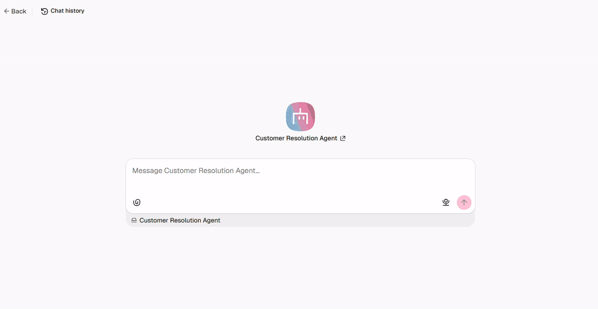

# Customer Resolution Agent



A no-code [n8n Agent](https://docs.n8n.io/build/build-and-manage-agents/) that helps a customer resolve an order issue using support policies and order records before proposing a human-approved resolution.

## Overview

Support requests rarely arrive in one predictable format. A customer may report a delayed order, a damaged delivery, a wrong item, or a return request. The next step depends on the details they provide, the order record, and the relevant policy.

This project uses the new n8n Agent feature rather than a fixed support workflow. The agent decides whether it needs to ask a follow-up question, search the knowledge base, look up an order, or prepare a resolution request. It cannot create a replacement, refund, or other consequential resolution without human approval.

The demo uses the Agent Builder's built-in Preview chat. This keeps the project self-contained: no bot account, webhook, or external channel is required to show the agent's reasoning loop, tool calls, session history, and approval pause. The example store data in `data/` is deliberately small and transparent. In a production system, the same read and write tools would connect to the store, CRM, or order-management system instead.

## Features

- A customer can report an order problem in the n8n Agent Builder Preview chat.
- The agent searches a help-centre knowledge base before explaining a policy.
- The agent looks up an order only when an order identifier is available.
- The agent asks for the missing detail instead of guessing.
- A resolution request pauses for human approval before it is written to the case table.
- n8n sessions retain the conversation and expose the agent's tool calls for review.

## How It Works

1. A customer sends the Agent Builder Preview chat an issue such as: “My order CM-1042 arrived damaged.”
2. The n8n Agent reads its instructions and decides what information it still needs.
3. It searches the Knowledge Base and, when appropriate, queries the `customer_orders` Data Table.
4. It explains the supported next step and asks the customer to confirm the requested resolution.
5. The agent requests approval before it invokes the write tool.
6. After approval, the write tool records the request in `resolution_requests` and the agent confirms the outcome in the same chat.

The agent decides when to use its tools. The Data Table operations are narrowly configured tools, so the lookup and write operations remain predictable and scoped.

## Tech Stack

| Component | Choice |
| --- | --- |
| Agent runtime | n8n Agents |
| Demo interface | n8n Agent Builder Preview chat |
| Knowledge | n8n Agent Knowledge Base |
| Order and case data | n8n Data Tables |
| Agent tools | Data Table lookup and insert operations |
| Human oversight | n8n sensitive-tool approval |
| Conversation memory | n8n session memory |
| Model | Any chat model configured in n8n |

## Prerequisites

- An [n8n Cloud](https://app.n8n.cloud) workspace is recommended for the simplest setup.
- Access to a chat model in n8n, either through n8n Gateway or your own provider credential.
- The files in this repository.

n8n Agents are currently in Preview. Agent behavior and the builder interface can change, so test the draft in Preview before publishing it. n8n lists Agents as available on Cloud plans. Self-hosted instances need n8n `2.32.3` or later, and self-hosted Knowledge Bases have additional sandbox requirements. See the [n8n Agent documentation](https://docs.n8n.io/build/build-and-manage-agents) for current availability details.

## Setup

### 1. Create an n8n project

Open your n8n workspace and create a new project named **Customer Resolution Demo**. Keep the agent, Data Tables, and credentials inside this project. Data tables are scoped to an n8n project.

### 2. Create the Data Tables

Open the project’s **Data tables** tab. Create the following tables by selecting **Create Data table** and choosing **Import CSV**.

| Table name | Repository file |
| --- | --- |
| `customer_orders` | `data/customer_orders.csv` |
| `resolution_requests` | `data/resolution_requests.csv` |

The `customer_orders` rows are fictional records for the demo. Do not upload real customer information to a public demonstration. n8n supports creating and importing Data Tables from the Data tables tab. [Data Tables documentation](https://docs.n8n.io/build/work-with-data/data-tables)

### 3. Create the Knowledge Base

Open **Agents**, select **Create Agent**, and name it **Customer Resolution Agent**. In the agent’s **Knowledge** tab, upload these Markdown files from the repository:

- `knowledge_base/shipping_and_delivery.md`
- `knowledge_base/damaged_or_wrong_items.md`
- `knowledge_base/returns_and_refunds.md`
- `knowledge_base/when_to_escalate.md`

These are example policies for a fictional store. They make the agent ground its replies in written policy rather than inventing a resolution.

### 4. Configure the model and instructions

In the Agent tab, select a chat model that is available in your workspace. Then copy the complete contents of [agent/instructions.md](agent/instructions.md) into the Agent’s **Instructions** field.

Session memory is enabled by default for the current conversation. Do not enable episodic memory for this demo because it is unnecessary for a single customer case and adds another credential requirement.

### 5. Add the two Data Table tools

In **Tools**, select **Add tool**, then choose the n8n Data Table integration. Create the two tools described in [agent/tool_contracts.md](agent/tool_contracts.md):

1. `lookup_customer_order` uses **Data table → Must Match** against `customer_orders`. It is read-only.
2. `create_resolution_request` inserts a row into `resolution_requests`. Mark this tool as **sensitive** so the agent must request approval before it runs.

Tool descriptions matter because the agent uses them to decide when each tool is appropriate. Keep the read tool limited to the `customer_orders` table and the write tool limited to the `resolution_requests` table.

### 6. Test in Preview

Use **Preview** in the Agent Builder to test the draft. Preview runs the current draft and creates an n8n session, so it is enough to demonstrate this project without publishing an external channel.

Follow the tested flow in the next section. n8n records the session, tool calls, and pending approvals in the Sessions view.

### 7. Use a channel when you need one

n8n Agents can also be published to channels including Slack, Telegram, Linear, and Microsoft Teams. A channel makes sense when real users need to reach the agent outside n8n.

This project intentionally uses the built-in Preview chat instead. It is the clearest way to demo the agent's decisions and human approval without adding a bot account, channel permissions, or webhook setup. If you later connect a channel, test the same flow in Preview first, then publish the tested version. [n8n channel documentation](https://docs.n8n.io/build/build-and-manage-agents#reach-agents-from-other-places)

## Demo

Open **Preview** in the Agent Builder and send:

```text
My order CM-1042 arrived damaged.
```

The agent should look up the order and retrieve the damaged-item policy. When it asks whether you want a replacement, reply:

```text
Yes, I would like a replacement.
```

The agent should propose a replacement request and pause with **Approve** and **Reject** controls before it can run `create_resolution_request`. Select **Approve**. The agent then confirms that the request is recorded, and a new row appears in `resolution_requests` with `pending_review` as its status.

For the demo recording, show the initial message, the order and policy lookup, the customer's replacement confirmation, the approval pause, the approved completion message, and the new `resolution_requests` row. This makes the agent's decision-making and human control visible in one short sequence.

## Project Structure

```text
customer_resolution_agent/
├── agent/
│   ├── instructions.md          # Paste into the n8n Agent Instructions field
│   └── tool_contracts.md        # Exact purpose and boundaries for both tools
├── assets/
│   └── demo.gif                 # Recorded n8n Agent demo
├── data/
│   ├── customer_orders.csv      # Import into the customer_orders Data Table
│   └── resolution_requests.csv  # Import into the resolution_requests Data Table
├── knowledge_base/
│   ├── damaged_or_wrong_items.md
│   ├── returns_and_refunds.md
│   ├── shipping_and_delivery.md
│   └── when_to_escalate.md
└── README.md
```

## Customising

Replace the fictional policies and demo rows before adapting this agent for another business. Keep the separation between read-only lookup tools and sensitive write tools. Add a new policy file when the agent needs a new support domain, rather than adding broad instructions that encourage it to guess.

For a production integration, replace the two Data Table tools with narrowly scoped tools that query and update the real order system. Preserve approval for any action that changes customer status, fulfilment, billing, or refund state.

## Resources

- [Introducing n8n Agents](https://blog.n8n.io/introducing-n8n-agents/)
- [Build and manage Agents](https://docs.n8n.io/build/build-and-manage-agents)
- [n8n Data Tables](https://docs.n8n.io/build/work-with-data/data-tables)
- [Data Table node operations](https://docs.n8n.io/integrations/builtin/core-nodes/n8n-nodes-base.datatable)
