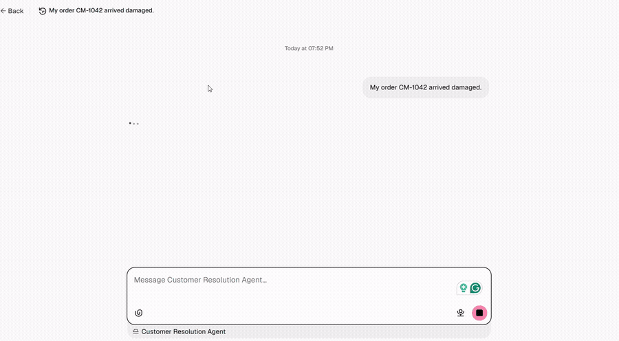

# Customer Resolution Agent

A no-code [n8n Agent](https://docs.n8n.io/build/build-and-manage-agents/) that handles an open-ended customer support conversation, then calls a defined workflow to record a resolution request.

The demo uses a fictional store, Northstar Goods. The agent checks support policies and order data, asks for missing information, and calls the workflow only after the customer confirms the supported resolution they want.



## Why an Agent and a Workflow

Customer messages are unpredictable. The agent decides whether it needs to ask a question, search a policy, look up an order, or record a request.

The resolution-recording step is predictable. It runs as the `Process Resolution Request` workflow tool, which checks that the requested resolution is allowed for the order and writes a `pending_review` record. It does not issue refunds, ship replacements, or change an order.

```text
Customer message → n8n Agent → policy + order lookup
                 → Process Resolution Request workflow → pending_review record
                 → agent response
```

## Tech Stack

| Component | Choice |
| --- | --- |
| Agent runtime | n8n Agents |
| Demo interface | n8n Agent Builder Preview chat |
| Knowledge | n8n Agent Knowledge Base |
| Data | n8n Data Tables |
| Agent tools | Read-only order lookup and workflow tool |
| Conversation memory | n8n session memory |
| Model | Any chat model configured in n8n |

## Setup

### 1. Import the demo data

In an n8n project, create these Data Tables by importing the repository CSV files:

| Table | File |
| --- | --- |
| `customer_orders` | `data/customer_orders.csv` |
| `resolution_requests` | `data/resolution_requests.csv` |

The rows are fictional and intended only for this demo.

### 2. Create the knowledge base

Create an agent named **Customer Resolution Agent**. In its **Knowledge** tab, upload the four Markdown files in `knowledge_base/`.

### 3. Create the workflow tool

Create the `Process Resolution Request` workflow before adding it to the agent. Follow the complete node setup in [workflows/process_resolution_request.md](workflows/process_resolution_request.md).

### 4. Configure the agent

1. Choose a chat model in the Agent Builder.
2. Paste [agent/instructions.md](agent/instructions.md) into **Instructions**.
3. Add the read-only `lookup_customer_order` Data Table tool using [agent/tool_contracts.md](agent/tool_contracts.md).
4. Add `Process Resolution Request` from **Capabilities → Add tools → Workflows** using the description in the same file.
5. Do not add the old direct `create_resolution_request` Data Table tool.

## Test the Demo

In **Preview**, send:

```text
My order CM-1042 arrived damaged.
```

When the agent asks what the customer wants, reply:

```text
I would like a replacement.
```

Expected result:

1. The agent retrieves the order and relevant policy.
2. It confirms that a replacement is supported and receives customer confirmation.
3. It calls `Process Resolution Request`.
4. The workflow validates the resolution and writes a `pending_review` row.
5. The agent confirms that the request was recorded for review.

### Verified run

The included demo records a replacement request for `CM-1042`. The workflow receives the order, customer email, requested resolution, confirmation, and agent note, then returns `status: success`. The agent confirms the request was recorded as `pending_review`; it does not claim that a replacement has been sent.

## Project Structure

```text
customer_resolution_agent/
├── agent/
│   ├── instructions.md
│   └── tool_contracts.md
├── assets/
│   └── demo.gif
├── data/
│   ├── customer_orders.csv
│   └── resolution_requests.csv
├── knowledge_base/
│   └── ...
├── workflows/
│   └── process_resolution_request.md
└── README.md
```

## Resources

- [Introducing n8n Agents](https://blog.n8n.io/introducing-n8n-agents/)
- [Build and manage n8n Agents](https://docs.n8n.io/build/build-and-manage-agents)
- [Execute Sub-workflow Trigger](https://docs.n8n.io/integrations/builtin/core-nodes/n8n-nodes-base.executeworkflowtrigger)
- [Data Table node](https://docs.n8n.io/integrations/builtin/core-nodes/n8n-nodes-base.datatable)
