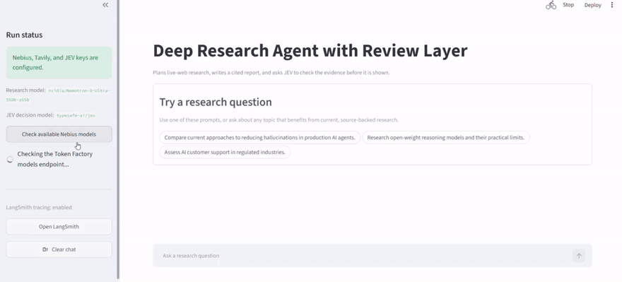

# Deep Research Agent with Review Layer



A web research agent that plans an investigation, gathers live evidence with Tavily, writes a cited report, and runs a separate review decision before presenting the result. It uses `nvidia/Nemotron-3-Ultra-550b-a55b` through Nebius Token Factory for research and JEV to assess evidence coverage and claim grounding.

The project is based on the modular approach in the Nebius deep-research blueprint. Orchestration, model inference, retrieval, evaluation, and tracing are independent parts of the stack, so each can be replaced without rebuilding the application.

## What it does

- Turns a question into a live-web research task.
- Uses a LangChain Deep Agent to plan and search with Tavily.
- Produces a Markdown report with numbered inline citations.
- Checks citations deterministically before the report is shown.
- Sends the report and retrieved evidence to JEV for an evidence-coverage and claim-grounding decision.
- Runs one additional research pass when JEV returns `research_again`.
- Shows the plan, Tavily searches, sources, review outcome, and LangSmith tracing status in Streamlit.

## Architecture

```text
Question
   │
   ▼
LangChain Deep Agent + NVIDIA Nemotron on Nebius Token Factory
   │
   ├── Tavily live-web search ──► numbered sources
   │
   ▼
Cited research report ──► citation check ──► JEV review
                                              │
                              approve ◄───────┴───────► research again, once
                                              │
                                              ▼
                                  Streamlit report + sources + trace
```

## Tech stack

- **Agent orchestration:** LangChain Deep Agents
- **Research model:** `nvidia/Nemotron-3-Ultra-550b-a55b` through Nebius Token Factory
- **Live-web retrieval:** Tavily
- **Review layer:** JEV
- **Tracing:** LangSmith
- **Interface:** Streamlit

## Nebius AI Builder Program

This project is powered by the [Nebius AI Builder Program](https://dev.nebius.com/builders#benefits). The research stack uses Nebius Token Factory for `nvidia/Nemotron-3-Ultra-550b-a55b` model inference, Tavily for live-web search, and LangSmith for tracing. These are all parts of the stack available to developers through the program.

At the time of writing, the program includes $25 in Token Factory credit, $25 in Tavily credit, and $100 in LangSmith credit. It also includes credits for evaluation tools, runnable cookbooks, technical office hours, a builder community, and a Nebius Academy certification offer.

Credits and partner offers are subject to eligibility, availability, and their individual terms. The program is primarily for learning and experimentation rather than production workloads. Check the [current benefits page](https://dev.nebius.com/builders#benefits) before relying on a specific offer.

## Prerequisites

- Python 3.12 or higher
- [uv](https://docs.astral.sh/uv/)
- A Tavily API key
- A Nebius Token Factory API key with access to a supported research model
- An API key with access to `typesafe-ai/jev`
- Optional: a LangSmith API key for traces

## Setup

Open PowerShell in this project folder:

```powershell
cd C:\Users\USER\Hands-On-AI-Engineering\ai_agents\deep_research_agent_with_review
```

Install the project and development dependencies:

```powershell
uv sync --group dev
```

Create your local environment file:

```powershell
Copy-Item .env.example .env
```

Open `.env` and add your API keys. Do not commit this file.

```dotenv
NEBIUS_API_KEY=your_nebius_token_factory_key
TAVILY_API_KEY=your_tavily_key
AI_GATEWAY_API_KEY=your_jev_api_key

# Optional, but recommended for visible execution traces.
LANGSMITH_API_KEY=your_langsmith_key
```

## Run the app

```powershell
uv run streamlit run main.py
```

Open the local URL shown in PowerShell, usually `http://localhost:8501`.

Try questions such as:

- `What are the latest approaches to reducing hallucinations in production AI agents? Compare the evidence and trade-offs.`
- `Research the current state of open-weight reasoning models. What has changed recently, and what are the practical limits?`
- `What are the strongest arguments for and against using AI agents for customer support in regulated industries?`

## How the review loop works

1. The Deep Agent plans the investigation and calls Tavily to collect current sources.
2. NVIDIA Nemotron writes a report whose factual claims use the source numbers returned by search.
3. Local code verifies that the report contains citations and that every citation refers to a retrieved source.
4. JEV decides whether the evidence covers the question and whether important claims are grounded. If either check is weak, the agent researches once more and JEV reviews the revision.

JEV does not write the report. It is deliberately limited to a structured review decision so that the research model, sources, and review layer remain distinct. Boolean review probabilities of 0.70 or above count as a pass in this first version.

## LangSmith tracing

Set `LANGSMITH_API_KEY` and keep `LANGSMITH_TRACING=true` in `.env`. Each Deep Agent run is then traced automatically. Use the **Open LangSmith** button in the sidebar to inspect plans, model calls, tool calls, and latency in the project named by `LANGSMITH_PROJECT`.

## Optional local checks

This is not required to launch the demo, but it verifies the citation and review-response logic without calling any external service:

```powershell
uv run python -m pytest -q
```

## Project structure

```text
deep_research_agent_with_review/
├── main.py                         # Streamlit chat interface
├── research_agent/
│   ├── workflow.py                 # Deep Agent, Tavily, revision loop
│   ├── review.py                   # JEV decision client
│   ├── nebius.py                   # Token Factory model discovery
│   └── validation.py               # Citation validation
├── scripts/list_nebius_models.py   # Read-only model availability check
├── tests/
├── .env.example
└── pyproject.toml
```

## Notes and limitations

- Search results can still be incomplete or wrong. The review layer makes gaps easier to catch, but it does not guarantee truth.
- The workflow performs at most one automatic revision to keep latency and cost predictable.
- This first version researches the live web. A future version can add Nebius embeddings with FAISS or Weaviate for private document retrieval.
- Check the Nebius Builder Program's current campaign details, disclosure requirements, and tracking link before publishing any partnership content.

## References

- [Nebius deep research agent cookbook](https://dev.nebius.com/cookbook/deep-research-agent-tavily)
- [Nebius Token Factory documentation](https://dev.nebius.com/)
- [Tavily documentation](https://docs.tavily.com/)
- [LangSmith documentation](https://docs.smith.langchain.com/)
