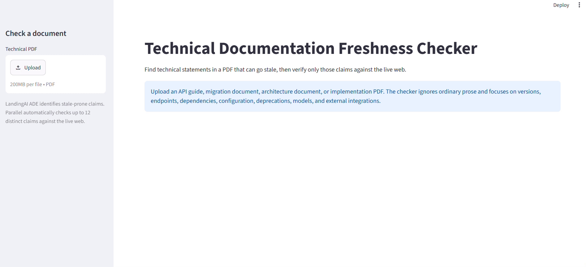

# Technical Documentation Freshness Checker



> Check which time-sensitive technical statements in a PDF are still supported by current web evidence.

## Overview

Technical documentation ages in small but expensive ways. An endpoint moves, a package version is no longer supported, a setup step changes, or a model is renamed. A reader can follow an old guide confidently and still build against the wrong thing.

This application checks only the statements that are likely to change. It parses a technical PDF with [LandingAI Agentic Document Extraction (ADE)](https://docs.landing.ai/dpt3/ade-python), extracts claims about versions, APIs, packages, configurations, deprecations, models, dependencies, and integrations, and automatically sends each distinct claim to the [Parallel Decisions API](https://docs.parallel.ai/decisions/decisions-quickstart). Parallel returns a bounded `CURRENT`, `OUTDATED`, or `NEEDS REVIEW` decision with confidence and live-web citations.

Every result keeps two evidence trails: the exact excerpt from the uploaded document and live-web citations returned by Parallel. It is not a generic fact checker for every sentence in a PDF.

## Why Parallel Decisions Instead of a Web Search API?

Suppose this application used a normal web search API. It could search for an old claim such as “Use the `/v1/engines` endpoint” and return a collection of current documentation pages, blog posts, and tutorials. The application would still need another model, or a human, to read those results and decide whether the original instruction is still valid.

That comparison is where the difficult part lives. Which sources are authoritative? Does the new documentation replace the old instruction or merely describe a different feature? What happens when the evidence is conflicting or does not answer the question clearly?

[Parallel Decisions](https://docs.parallel.ai/decisions/decisions-quickstart) handles that bounded decision. For every claim ADE extracts, the application asks one explicit question with three possible outcomes: `CURRENT`, `OUTDATED`, or `NEEDS REVIEW`. Parallel retrieves current web evidence, evaluates it against the criteria, returns a confidence score, and includes the citations used for the decision.

That means the application does not treat a list of search links as an answer. It automatically creates a review queue: outdated guidance and uncertain cases need attention, while verified current guidance remains available as an audit record.

## Tested Result

We tested the application with an older [OpenAI API Beta documentation PDF](https://static.packt-cdn.com/downloads/9781800563193_ColorImages.pdf). It contains legacy API endpoints, model names, pricing, and setup examples, making it a useful test for documentation that has aged.

LandingAI ADE identified 12 time-sensitive technical claims. Parallel Decisions checked them automatically and returned:

- **7 outdated:** legacy Engines routes, `davinci`-based completion examples, older model names, historic pricing, an old content-filter route, and the Python 3.8.2 runtime example.
- **1 current:** the `/v1/files` endpoint is still documented.
- **4 needs review:** claims where the current evidence was insufficient, unclear, or not strong enough for the system to make a safe decision.

This is the intended behaviour. The checker does not turn uncertainty into an “outdated” verdict. It automatically surfaces only the outdated and uncertain claims for a developer to review, while keeping current claims in a separate audit section. In the test, the legacy Engines and `davinci` completion routes were useful examples of stale guidance; the still-current Files endpoint showed that the system can preserve valid instructions rather than flagging every old document claim.

## How It Works

1. **Upload a technical PDF.** LandingAI ADE converts it into layout-aware Markdown.
2. **Identify stale-prone claims.** ADE extracts only technical statements that might change over time.
3. **Verify automatically.** Parallel Decisions evaluates every extracted claim with an explicit three-way choice.
4. **Review exceptions.** The app surfaces `OUTDATED` and `NEEDS REVIEW` items, while keeping verified current claims in an audit section.
5. **Inspect both evidence trails.** Each exception shows the source quote from the PDF and the live-web citations used for the decision.

## Tech Stack

| Layer | Choice |
|---|---|
| Document understanding | [LandingAI ADE](https://docs.landing.ai/dpt3/ade-python), `dpt-3-pro-latest` |
| Claim selection | LandingAI ADE structured extraction with a Pydantic schema |
| Freshness decisions | [Parallel Decisions API](https://docs.parallel.ai/decisions/decisions-quickstart) |
| Decision outputs | `CURRENT`, `OUTDATED`, `NEEDS REVIEW` choice criteria |
| UI | Streamlit |
| Packaging | Python 3.10+, `uv`, `pyproject.toml` |

## Prerequisites

- Python 3.10 or higher.
- `uv`. Install it from [Astral's uv documentation](https://docs.astral.sh/uv/getting-started/installation/).
- A LandingAI API key. The ADE Python client reads it from `VISION_AGENT_API_KEY`.
- A Parallel API key from [Parallel Platform](https://platform.parallel.ai). The Decisions API reads it from `PARALLEL_API_KEY`.

## Installation

Clone the repository and open this project in PowerShell:

```powershell
git clone https://github.com/Sumanth077/Hands-On-AI-Engineering.git
cd Hands-On-AI-Engineering\ai_agents\technical_documentation_freshness_checker
```

Install the application and test dependencies:

```powershell
uv sync --group dev
```

Create the local environment file:

```powershell
Copy-Item .env.example .env
```

Open `.env` and add the two keys:

```dotenv
VISION_AGENT_API_KEY=your_landingai_api_key
PARALLEL_API_KEY=your_parallel_api_key
```

## Run the App

```powershell
uv run streamlit run app.py
```

Streamlit opens the app at `http://localhost:8501`.

1. Upload an older technical PDF, such as an implementation guide, API guide, migration guide, or architecture document.
2. Click **Check document freshness**.
3. Wait while ADE identifies stale-prone claims and Parallel checks them automatically.
4. Review the `OUTDATED` and `NEEDS REVIEW` items that need attention.
5. Open **Document evidence** to see the original quote and **Live web evidence** to inspect the citations.


To try it, use a document that contains a dated API version, package version, model name, deprecated feature, or setup instruction. The strongest result is one where the document says, for example, “Use API v1,” and current official documentation indicates a different recommended version.

The result screen makes the distinction visible:

- **Document evidence:** what the original PDF said.
- **Live web evidence:** what the current sources say.
- **Decision:** `CURRENT`, `OUTDATED`, or `NEEDS REVIEW` when the evidence is not decisive.

## Test

The included test verifies the local claim-selection boundary. It does not call either external API.

```powershell
uv run pytest -q
```

## Project Structure

```text
technical_documentation_freshness_checker/
├── app.py                         # Upload, automatic check, and exception-review UI
├── assets/
│   └── demo.gif                    # Add the recorded demo here
├── freshness_checker/
│   ├── ade.py                     # LandingAI ADE parse and structured extraction
│   ├── claims.py                  # Claim de-duplication and automatic safety limit
│   ├── decisions.py               # Parallel Decisions request and status mapping
│   └── models.py                  # Shared schemas and result models
├── tests/
│   └── test_claims.py             # Local claim selection test
├── .env.example                   # Required API key names
├── pyproject.toml                 # Dependencies and uv configuration
└── README.md
```

## Notes

- LandingAI ADE processes the uploaded PDF. The application uses its parsed Markdown and structured extraction output to identify claims for review.
- Parallel receives only the stale-prone claims extracted by ADE, plus short supporting document context. It does not receive the entire PDF.
- A `NEEDS REVIEW` result is intentional. Parallel's documented `choice` question type supports an explicit insufficient-evidence outcome, rather than treating missing evidence as a negative result.
- Decisions API citations contain the page URL, optional title, and the evidence excerpts returned by Parallel. Review them before acting on an `OUTDATED` result.

## Resources

- [LandingAI ADE Python Library](https://docs.landing.ai/dpt3/ade-python)
- [LandingAI ADE parsing documentation](https://docs.landing.ai/dpt3/parse)
- [Parallel Decisions API Quickstart](https://docs.parallel.ai/decisions/decisions-quickstart)
- [Parallel Decisions question types](https://docs.parallel.ai/decisions/question-types)
- [Parallel Decisions best practices](https://docs.parallel.ai/decisions/best-practices)
