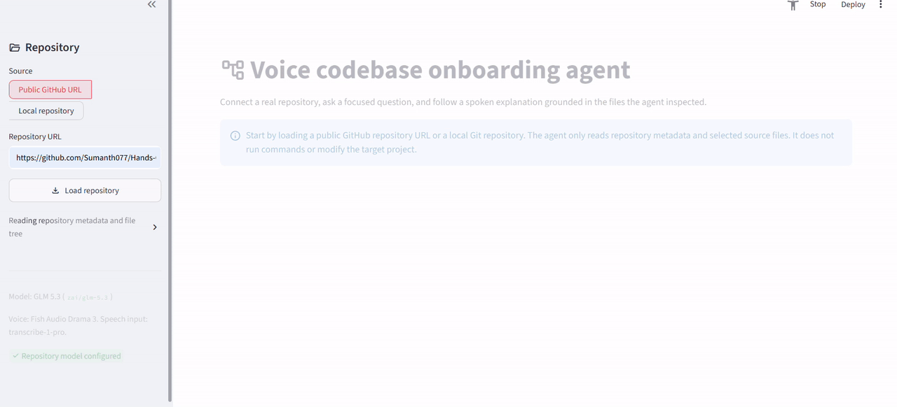
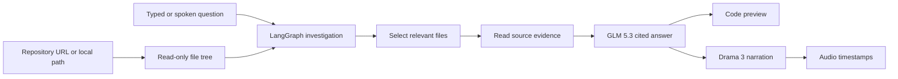

# Voice Codebase Onboarding Agent



An agent that helps developers understand a real codebase through text or voice. Load a public GitHub repository or a local Git repository, then ask a focused question such as, “Where does authentication happen?” or “Where should I start to change the UI?” The agent reads a small, relevant set of files, answers with file-and-line citations, and narrates the explanation with Fish Audio Drama 3.

This is not a generic repository summary. The agent plans a read-only investigation for each question, selects relevant files from the actual repository tree, reads those files, and grounds its answer in the evidence it collected.

## Features

- Load any public GitHub repository URL or a local Git repository path.
- Ask codebase questions by typing or speaking.
- Inspect repository metadata, the file tree, manifests, entry points, and targeted source files without modifying the target project.
- Receive concise answers with citations such as `[main.py:42]`.
- Open the exact files inspected for the latest answer in the side panel.
- Listen to a Fish Audio Drama 3 narration of the answer.
- Inspect word-level timestamps returned with the narration.
- Use Fish Audio `transcribe-1-pro` for optional microphone questions.

## Architecture



1. The user loads a real repository from GitHub or a local path.
2. The agent reads repository metadata and a filtered file tree. It does not execute commands in the target repository.
3. LangGraph asks GLM 5.3 to choose up to six relevant files for the question.
4. The app reads only those files and asks the model for an evidence-backed explanation with file-and-line citations.
5. The Streamlit interface displays the answer and source preview, then Fish Audio Drama 3 narrates the explanation with timestamps.

## Tech stack

| Component | Choice |
| --- | --- |
| Repository data | GitHub REST API and local read-only file access |
| Agent orchestration | LangGraph |
| Reasoning model | GLM 5.3 (`zai/glm-5.3`) |
| Expressive narration | Fish Audio Drama 3 |
| Speech input | Fish Audio `transcribe-1-pro` |
| Interface | Streamlit |

## Prerequisites

- Python 3.10 or later
- [uv](https://docs.astral.sh/uv/getting-started/installation/)
- An LLM API key for GLM 5.3
- A Fish Audio API key for narration and optional speech input
- A public GitHub repository URL, or a local Git repository path

`GITHUB_TOKEN` is optional. Public repositories work without it, but a token raises GitHub API limits.

## Set up and run

Open **PowerShell** in VS Code and run:

```powershell
cd C:\Users\USER\Hands-On-AI-Engineering\ai_agents\voice_codebase_onboarding_agent
uv sync --extra dev
Copy-Item .env.example .env
```

Open `.env` and add your keys:

```dotenv
AI_GATEWAY_API_KEY=your_ai_gateway_key
FISH_API_KEY=your_fish_audio_api_key
```

The configured model is already set to `zai/glm-5.3`. Do not change it unless you intentionally want to test another compatible model.

`FISH_REFERENCE_ID` is optional. When it is blank, the project uses Fish Audio's documented public Delia voice for Drama 3 narration.

Start the application:

```powershell
uv run streamlit run main.py
```

Open the local URL printed in the terminal, usually `http://localhost:8501`.

## Demo flow

Use a public repository you know well, such as:

```text
https://github.com/Sumanth077/Hands-On-AI-Engineering
```

1. Paste the URL into the sidebar and click **Load repository**.
2. Ask one of the suggested questions, or try these:

```text
What is the main entry point of this repository?

Where should I start if I want to change the user interface?

Where does authentication happen? Trace the relevant flow.
```

3. Show the agent's read-only investigation plan and cited answer.
4. Use the right panel to open one of the source files it inspected.
5. Play the Drama 3 explanation. Open **Drama 3 narration script and timestamps** to show the directed narration and word-level timing.

For an optional speech-input moment, use the microphone button in the chat input and ask one of the same questions aloud. Allow browser microphone access when prompted.

## Safety and scope

- Repository exploration is read-only. The agent does not run builds, tests, shell commands, migrations, or code changes in the target project.
- GitHub access is limited to public repository metadata, file trees, and selected source files.
- For local repositories, the app verifies that the selected directory is a Git repository and prevents source reads outside that directory.
- The model is instructed to cite supplied code evidence and to state when the inspected files do not answer a question.

## Project structure

```text
voice_codebase_onboarding_agent/
├── assets/                 # Add the recorded demo GIF here
├── codebase_guide/
│   ├── repository.py       # GitHub and local read-only repository readers
│   ├── workflow.py         # LangGraph investigation flow
│   ├── llm.py              # GLM 5.3 compatible API client
│   └── fish_audio.py       # Fish Audio ASR and Drama 3 narration
├── tests/
├── .env.example
├── main.py
└── pyproject.toml
```

## Test the project

Run the focused tests after installing the development dependencies:

```powershell
uv run pytest -q
```

## Fish Audio notes

The project uses the documented [Drama 3](https://docs.fish.audio/features/text-to-speech/drama-3) model header, `drama-3`, to generate a clear, directed technical walkthrough. Fish Audio's [timestamped TTS endpoint](https://docs.fish.audio/api-reference/endpoint/openapi-v1/text-to-speech-stream-with-timestamps) returns audio and word timing, while the [speech-to-text endpoint](https://docs.fish.audio/api-reference/endpoint/openapi-v1/speech-to-text) handles optional microphone questions with `transcribe-1-pro`.

