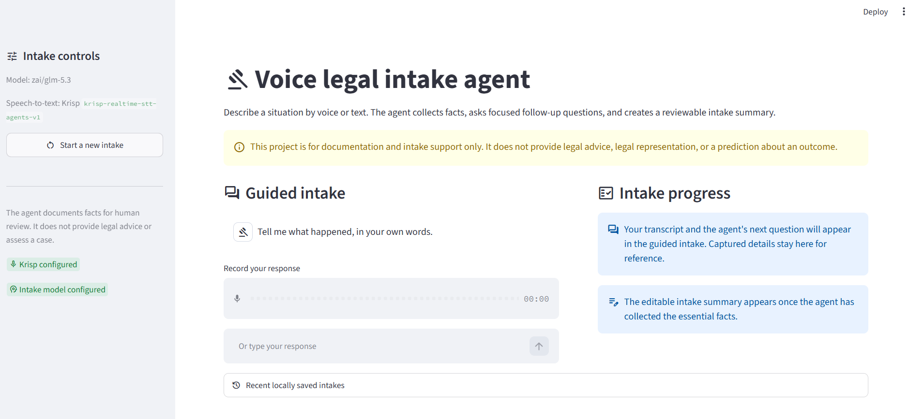
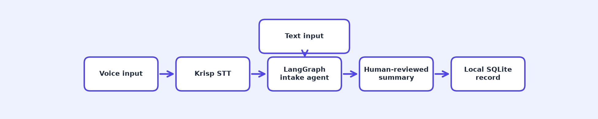

# Voice Legal Intake Agent



A voice-first agent that turns an unstructured explanation into a structured intake summary for human review.

## Overview

Legal and administrative intake often starts with a person explaining a situation in their own words. Important dates, people, evidence, and unanswered questions can be buried in that first account. This project uses voice or text input to collect those facts, ask one focused follow-up question at a time, and prepare a reviewable summary.

The agent is designed for documentation support only. It does not give legal advice, interpret law, assess a case, predict an outcome, or replace a qualified legal professional.

## How It Works



1. The user records a response in the browser or types it.
2. Krisp transcribes a voice response with `krisp-realtime-stt-agents-v1`.
3. The LangGraph intake agent extracts supplied facts, identifies one meaningful information gap, and asks the next neutral question.
4. Once the essential intake areas are covered, the app creates a factual Markdown draft.
5. A human reviews, edits, downloads, or saves the approved summary locally.

Krisp STT runs through its documented realtime WebSocket protocol. The app creates a short-lived session token on the server, then sends the 16 kHz browser recording as raw audio frames. The long-lived Krisp key stays in `.env` and is never sent to the browser.

## Tech Stack

| Component | Choice |
| --- | --- |
| Speech-to-text | Krisp `krisp-realtime-stt-agents-v1` |
| Agent harness | LangGraph |
| Reasoning model | GLM 5.3 (`zai/glm-5.3`) |
| Structured data | Pydantic |
| Local storage | SQLite |
| Interface | Streamlit |

## Prerequisites

- Python 3.10 or later
- [uv](https://docs.astral.sh/uv/getting-started/installation/)
- A Krisp API key with Speech-to-Text access
- An AI Gateway API key for the configured model
- A browser with microphone access for the voice demonstration

Krisp Speech-to-Text is currently beta. Models, messages, and limits can change before general availability. Check the current [Krisp STT documentation](https://sdk-docs.krisp.ai/docs/realtime-stt) before deploying beyond local development.

## Setup

Clone the repository and open PowerShell in the project directory.

```powershell
git clone https://github.com/Sumanth077/Hands-On-AI-Engineering.git
cd Hands-On-AI-Engineering\ai_agents\voice_legal_intake_agent
```

Create and activate a virtual environment, then install the project and its test tools.

```powershell
uv venv
.\.venv\Scripts\Activate.ps1
uv pip install -e ".[dev]"
```

Copy the environment template.

```powershell
Copy-Item .env.example .env
```

Open `.env` and fill in the required values.

```dotenv
KRISP_API_KEY=your_krisp_api_key
AI_GATEWAY_API_KEY=your_ai_gateway_api_key
LLM_MODEL=zai/glm-5.3
```

`KRISP_API_KEY` comes from **API Keys** in the [Krisp Developers Portal](https://developers.krisp.ai). It is used only by the local Python process to create short-lived STT session tokens.

`AI_GATEWAY_API_KEY` is the key for the OpenAI-compatible endpoint used by the intake model. The project defaults to the exact model ID `zai/glm-5.3`.

## Running

Start the application with the activated virtual environment.

```powershell
streamlit run main.py
```

Open the local URL printed in PowerShell, usually `http://localhost:8501`.

## Demo

1. Confirm that the sidebar shows **Krisp configured** and **Intake model configured**.
2. Click the microphone control and record a short explanation of a situation. For example: “My landlord changed the locks after I asked about a repair. I have messages and photographs, but I am not sure of the exact date.”
3. Allow browser microphone access when prompted.
4. Show the Krisp transcript, the agent’s next question, and the structured intake record updating beside the conversation.
5. Continue until the agent marks the intake ready for review.
6. Edit the Markdown summary if needed, download it, or save the reviewed version locally.

You can also open `demo.html` directly in a browser for a lightweight, no-server visual preview.

## Project Structure

```text
voice_legal_intake_agent/
├── assets/
│   └── how_it_works.png
├── legal_intake/
│   ├── agent.py            # Bounded LangGraph intake flow
│   ├── krisp.py            # Krisp token and STT client
│   ├── llm.py              # GLM 5.3 gateway client
│   ├── models.py           # Typed intake records
│   └── storage.py          # Local reviewed-summary store
├── scripts/
│   └── generate_flowchart.py
├── tests/
├── .env.example
├── demo.html
├── main.py
├── pyproject.toml
└── README.md
```

## Customising

Change `LLM_MODEL` in `.env` only if you want to use another compatible model. The prompts and Pydantic validation keep the agent focused on factual intake rather than legal advice.

Add domain-specific terms to the `vocabulary` list in `legal_intake/krisp.py` when a particular practice area has recurring names or terminology.

The local SQLite database is created only after a user saves a reviewed intake. Delete `data/intakes.sqlite3` if you want to remove locally stored reviewed summaries.

## Test the Project

Run the offline tests without using either API.

```powershell
pytest -q
```

## Resources

- [Krisp Speech-to-Text overview](https://sdk-docs.krisp.ai/docs/realtime-stt)
- [Krisp STT for voice agents](https://sdk-docs.krisp.ai/docs/realtime-stt-agents)
- [Krisp authentication and session tokens](https://sdk-docs.krisp.ai/docs/authentication)
- [LangGraph documentation](https://langchain-ai.github.io/langgraph/)
- [GLM 5.3 model details](https://vercel.com/ai-gateway/models/glm-5.3)
