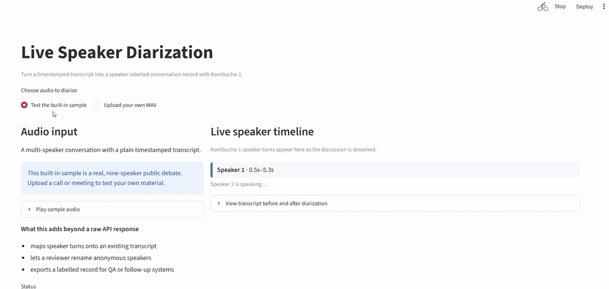

# Build Live Speaker Diarization With Kombucha-1

A Streamlit demo that turns a timestamped transcript into a speaker-labelled conversation record using [Kombucha-1](https://platform.meetjamie.ai/introducing-kombucha-1).

Kombucha-1 receives audio and returns anonymous speaker IDs with timestamps. The app keeps the API token on the Python server, displays speaker turns as they arrive, maps them onto an existing plain transcript, lets a reviewer rename the people, and exports the final result as Markdown or JSON.



## How it works

```text
16 kHz mono PCM conversation audio
→ server-side Kombucha-1 WebSocket
→ live speaker segments
→ speaker-attributed transcript and talk-time roster
→ renamed labels and export
```

The app sends raw 16-bit PCM, 16 kHz mono audio in 100 ms frames. It waits for the initial `session` message before streaming, then renders `speakers` events as they arrive. After the audio ends, it sends `finalize` and uses the `final` response for the completed export.

## Setup

1. Create a Kombucha-1 platform token in the [Jamie Platform console](https://platform.meetjamie.ai/keys).
2. Copy `.env.example` to `.env` and add the token:

   ```text
   KOMBUCHA_API_KEY=jp_your_platform_token
   ```

3. Install dependencies:

   ```bash
   uv sync
   ```

4. Start the app:

   ```bash
   uv run streamlit run app.py
   ```

## Try the demo

Choose **Test the built-in sample** to verify the end-to-end connection with a real multilingual, large-group debate. Kombucha-1 returned nine distinct speaker IDs from this ten-minute sample.

Choose **Upload your own WAV** to diarize another recording. Kombucha-1 requires an uncompressed 16-bit PCM WAV at 16 kHz in mono. The uploaded audio is written to a temporary server-side file only for the stream, then removed.

To use the full transcript-attribution flow with an upload, add an optional JSON file in this format:

```json
[
  {"start_ms": 0, "end_ms": 2400, "text": "A plain transcript line."}
]
```

Without a transcript, the app still shows the live speaker timeline, talk time, and downloadable speaker-turn JSON.

## Expected demo audio

The bundled sample is an uncompressed WAV at:

```text
assets/european_parliament_debate.wav
```

It uses 16-bit PCM, a 16 kHz sample rate, and one audio channel. The sample is the original-language audio from the European Parliament's ten-minute [State of the Union debate round](https://audiovisual.ec.europa.eu/en/media/video/I-293089), which contains more than eight people speaking. `assets/plain_transcript.json` is made from the accompanying official, auto-generated English subtitle track and deliberately has no speaker names.

In an end-to-end verification run, Kombucha-1 returned nine distinct anonymous speakers across 28 final segments. The sample is intentionally multilingual: it demonstrates speaker diarization without assuming that every participant uses one language.

## Why this is more than the playground

The platform playground is useful for trying the API. This app shows how a developer can use its output in a product workflow: begin with an existing timestamped transcript, connect it to the live speaker turns, assign useful roles such as `Host` or `Customer`, and export a record another reviewer or system can use.

## What the demo covers

The application is deliberately limited to speaker diarization. It does not perform speech-to-text, meeting summarisation, or conversation scoring. It shows the speaker layer returned by Kombucha-1: when each anonymous speaker talks, how long they talk, and how those labels can be renamed for export.

## Resources

- [Kombucha-1 announcement](https://platform.meetjamie.ai/introducing-kombucha-1)
- [Streaming endpoint documentation](https://jamie-9c8bb406-docs-platform-mintlify.mintlify.site/platform/streaming)
- [Server message documentation](https://jamie-9c8bb406-docs-platform-mintlify.mintlify.site/platform/server-messages)
